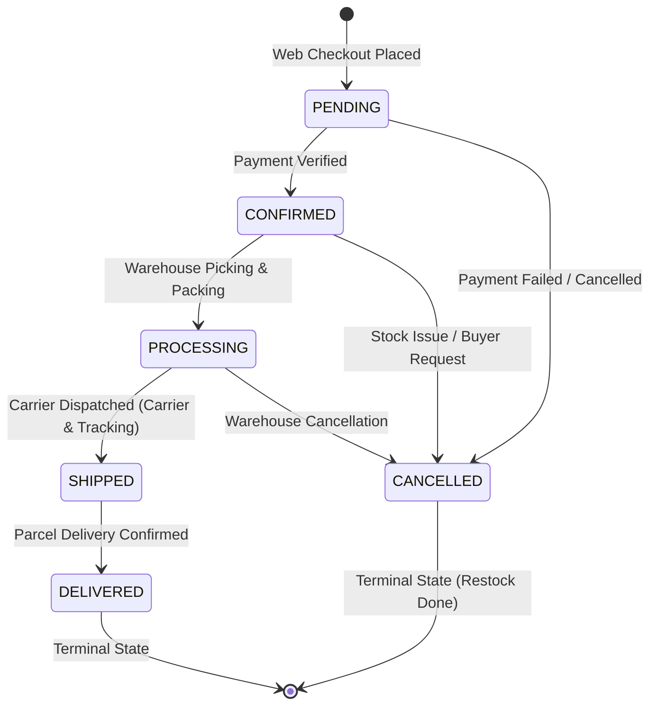

# Data Model & Schema Specification: Admin Order Management

**Feature**: `001-admin-order-management`  
**Date**: 2026-10-30  
**Status**: Ready  

---

## 1. Domain Entities & Database Model (Prisma)

### Entity: `Order` (`orders` table)

Represents a customer purchase through the online e-commerce storefront.

| Field | Type | Attributes | Description |
| :--- | :--- | :--- | :--- |
| `id` | `String` | `@id @default(uuid())` | Unique order identifier |
| `userId` | `String` | Foreign Key → `users.id` | Buyer user identifier |
| `status` | `String` | `@default("PENDING")` | Current status in lifecycle |
| `subtotal` | `Decimal` | `@db.Decimal(10, 2)` | Net order total before taxes |
| `taxes` | `Decimal` | `@db.Decimal(10, 2)` | Tax amount (16% IVA) |
| `total` | `Decimal` | `@db.Decimal(10, 2)` | Gross order total payable |
| `shippingAddress`| `String`| Required | Destination delivery address |
| `carrier` | `String?` | Optional | Shipping company name |
| `trackingNumber`| `String?`| Optional | Parcel tracking code |
| `cancellationReason` | `String?` | Optional | Reason provided if cancelled |
| `createdAt` | `DateTime` | `@default(now())` | Order creation timestamp |
| `updatedAt` | `DateTime` | `@updatedAt` | Last state modification timestamp |

#### Relationships
- `user`: Belongs to `User` (`fields: [userId], references: [id]`).
- `items`: Has many `OrderItem` (`onDelete: Cascade`).
- `payments`: Has many `Payment` (`onDelete: Cascade`).

---

### Entity: `OrderItem` (`order_items` table)

Represents an individual product line in an order with immutable historical snapshots.

| Field | Type | Attributes | Description |
| :--- | :--- | :--- | :--- |
| `id` | `String` | `@id @default(uuid())` | Unique item line identifier |
| `orderId` | `String` | Foreign Key → `orders.id` | Associated order identifier |
| `productId` | `String` | Foreign Key → `products.id`| Referenced product identifier |
| `productName` | `String` | Required | Immutable snapshot of product name |
| `sku` | `String` | Required | Immutable snapshot of product SKU |
| `unitPrice` | `Decimal` | `@db.Decimal(10, 2)` | Price charged per unit at sale time |
| `quantity` | `Int` | Required, `> 0` | Units purchased |
| `totalPrice` | `Decimal` | `@db.Decimal(10, 2)` | Line total (`unitPrice * quantity`) |

---

### Entity: `StockMovement` (`stock_movements` table)

Audit record for inventory restitution during order cancellation.

| Field | Type | Attributes | Description |
| :--- | :--- | :--- | :--- |
| `id` | `String` | `@id @default(uuid())` | Movement record identifier |
| `inventoryId` | `String` | Foreign Key → `inventories.id` | Target product inventory |
| `type` | `String` | `'IN'` | Inbound replenishment movement |
| `quantity` | `Int` | Positive integer | Quantity restored |
| `reason` | `String?` | Text | E.g., `"Cancelled Order #<ID>: <reason>"` |
| `userId` | `String?` | Foreign Key → `users.id` | Performing administrator ID |
| `createdAt` | `DateTime` | `@default(now())` | Movement timestamp |

---

## 2. Order Lifecycle State Transitions



### Transition Validation Rules
1. **`PENDING` → `CONFIRMED`**: Allowed when payment is completed.
2. **`CONFIRMED` → `PROCESSING`**: Allowed when warehouse begins assembly.
3. **`PROCESSING` → `SHIPPED`**: Requires non-empty `carrier` and `trackingNumber`.
4. **`SHIPPED` → `DELIVERED`**: Allowed upon courier delivery confirmation.
5. **`*` → `CANCELLED`**:
   - Permitted ONLY from `PENDING`, `CONFIRMED`, or `PROCESSING`.
   - FORBIDDEN from `SHIPPED` (must use Returns workflow).
   - FORBIDDEN from `DELIVERED` (already in terminal state).
   - FORBIDDEN from `CANCELLED` (already cancelled).
   - Requires non-empty `cancellationReason`.
   - Triggers automated atomic stock restitution (`type: 'IN'`).

---

## 3. Zod Validation Contracts (DTOs)

### `updateOrderStatusSchema`
```typescript
z.object({
  status: z.enum(['CONFIRMED', 'PROCESSING', 'SHIPPED', 'DELIVERED']),
  carrier: z.string().min(2, "Carrier name is required when shipping").optional(),
  trackingNumber: z.string().min(4, "Tracking code is required when shipping").optional(),
}).refine(data => {
  if (data.status === 'SHIPPED') {
    return Boolean(data.carrier && data.trackingNumber);
  }
  return true;
}, {
  message: "Carrier and tracking number are mandatory when updating status to SHIPPED",
  path: ["trackingNumber"]
});
```

### `cancelOrderSchema`
```typescript
z.object({
  cancellationReason: z.string().min(5, "Cancellation reason must be at least 5 characters long"),
});
```

### `orderQuerySchema`
```typescript
z.object({
  page: z.coerce.number().int().positive().default(1),
  limit: z.coerce.number().int().positive().max(100).default(20),
  status: z.enum(['PENDING', 'CONFIRMED', 'PROCESSING', 'SHIPPED', 'DELIVERED', 'CANCELLED']).optional(),
  search: z.string().optional(),
});
```

