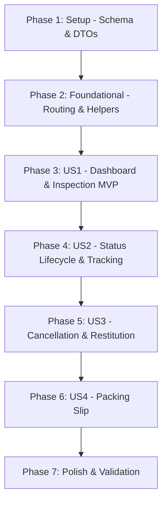

# Tasks: Admin Order Management & Fulfillment

**Input**: Design documents from `/specs/001-admin-order-management/` (`plan.md`, `spec.md`, `data-model.md`, `contracts/orders.contract.yaml`, `quickstart.md`)

**Prerequisites**: `plan.md` (completed), `spec.md` (completed), `data-model.md` (completed), `contracts/` (completed)

**Tests**: Automated unit and integration tests are included in accordance with Project Constitution Principle III and Quality Gates.

**Organization**: Tasks are grouped by user story to enable independent implementation, testing, and MVP delivery of each story.

## Format: `- [ ] [TaskID] [P?] [Story?] Description with file path`

- **[P]**: Can run in parallel (different files, no dependencies)
- **[Story]**: Which user story this task belongs to (`[US1]`, `[US2]`, `[US3]`, `[US4]`)
- Every task includes explicit file paths

---

## Phase 1: Setup (Schema & Foundation)

**Purpose**: Database schema expansion, migration, and base DTOs for order fulfillment

- [X] T001 Extend `Order` model in `backend/prisma/schema.prisma` with `carrier String?`, `trackingNumber String?`, and `cancellationReason String?`
- [X] T002 [P] Create DTO validation schemas (`orderQuerySchema`, `updateOrderStatusSchema`, `cancelOrderSchema`) in `backend/src/modules/orders/orders.schema.ts`
- [X] T003 Execute Prisma schema push/generation via command line to update `@prisma/client` types

---

## Phase 2: Foundational (Routing & Shared Middleware)

**Purpose**: Core administrative routing structure and RBAC permissions for order operations

- [X] T004 [P] Configure administrative route structure in `backend/src/modules/orders/orders.routes.ts` protected by `protect` and `requirePermission('PROCESS_SALES')`
- [X] T005 [P] Setup test fixture helpers for creating orders, items, and payments in `backend/tests/helpers/order.helper.ts`

**Checkpoint**: Foundation ready — User Story 1 implementation can now begin.

---

## Phase 3: User Story 1 - Centralized Order Dashboard & Inspection (Priority: P1) 🎯 MVP

**Goal**: Deliver a paginated order list dashboard with status filters and detailed order inspection view for store operators.

**Independent Test**: Administrators can query `GET /api/v1/orders?page=1&limit=10&status=PROCESSING` to receive paginated orders, and view order line items and pricing snapshots in the frontend.

### Tests for User Story 1

- [X] T006 [P] [US1] Unit test for `getOrders` pagination and `getOrderById` in `backend/tests/unit/orders.service.spec.ts`
- [X] T007 [P] [US1] Supertest integration test for `GET /api/v1/orders` and `GET /api/v1/orders/:id` in `backend/tests/integration/orders.api.spec.ts`

### Implementation for User Story 1

- [X] T008 [US1] Implement `getOrders` (paginated with filters) and `getOrderById` in `backend/src/modules/orders/orders.service.ts`
- [X] T009 [US1] Implement `getOrders` and `getOrderById` controllers in `backend/src/modules/orders/orders.controller.ts`
- [X] T010 [US1] Wire `GET /` and `GET /:id` administrative routes in `backend/src/modules/orders/orders.routes.ts`
- [X] T011 [P] [US1] Create order management list component with status filters, search, and pagination in `frontend/src/features/admin/OrdersList.tsx`
- [X] T012 [P] [US1] Create order detail modal displaying shipping address, line items, pricing snapshots, and payments in `frontend/src/features/admin/OrderDetailModal.tsx`
- [X] T013 [US1] Register `/admin/orders` route in `frontend/src/routes/AppRouter.tsx` and add Orders navigation entry to `frontend/src/layouts/AdminLayout.tsx`

**Checkpoint**: At this point, User Story 1 is fully functional and delivers an independently testable MVP.

---

## Phase 4: User Story 2 - Order Status Lifecycle & Fulfillment Progression (Priority: P2)

**Goal**: Implement deterministic state machine transitions with mandatory carrier and tracking code capture on shipment dispatch.

**Independent Test**: Take an order in `PROCESSING` state, update to `SHIPPED` with carrier and tracking code, verify state changes, and verify that invalid transitions (e.g., retrograde transitions) are rejected.

### Tests for User Story 2

- [X] T014 [P] [US2] Unit test for order state machine transitions and carrier validation in `backend/tests/unit/orders.service.spec.ts`
- [X] T015 [P] [US2] Supertest integration test for `PATCH /api/v1/orders/:id/status` in `backend/tests/integration/orders.api.spec.ts`

### Implementation for User Story 2

- [X] T016 [US2] Implement state transition map and `updateOrderStatus` method with audit logging in `backend/src/modules/orders/orders.service.ts`
- [X] T017 [US2] Implement `updateOrderStatus` controller in `backend/src/modules/orders/orders.controller.ts`
- [X] T018 [US2] Wire `PATCH /:id/status` route with `updateOrderStatusSchema` validation in `backend/src/modules/orders/orders.routes.ts`
- [X] T019 [US2] Add status progression action buttons and tracking prompt modal to `frontend/src/features/admin/OrderDetailModal.tsx`

**Checkpoint**: User Stories 1 and 2 operate together, enabling end-to-end order tracking.

---

## Phase 5: User Story 3 - Order Cancellation & Automated Inventory Restitution (Priority: P3)

**Goal**: Enable administrators to cancel unfulfilled orders with automatic, atomic inventory restitution, payment refund marking, and Redis cache invalidation.

**Independent Test**: Cancel an order purchasing Product A, confirm inventory increments by the exact ordered quantity with a `StockMovement` of type `'IN'`, order status becomes `CANCELLED`, and payment becomes `REFUNDED`.

### Tests for User Story 3

- [X] T020 [P] [US3] Unit test for atomic order cancellation and stock restitution in `backend/tests/unit/orders.service.spec.ts`
- [X] T021 [P] [US3] Supertest integration test for `POST /api/v1/orders/:id/cancel` in `backend/tests/integration/orders.api.spec.ts`

### Implementation for User Story 3

- [X] T022 [US3] Implement `cancelOrder` with interactive transaction, sorted item ordering, inventory increment, and Redis cache invalidation in `backend/src/modules/orders/orders.service.ts`
- [X] T023 [US3] Implement `cancelOrder` controller in `backend/src/modules/orders/orders.controller.ts`
- [X] T024 [US3] Wire `POST /:id/cancel` route with `cancelOrderSchema` validation in `backend/src/modules/orders/orders.routes.ts`
- [X] T025 [US3] Add cancellation confirmation dialog with mandatory reason text input to `frontend/src/features/admin/OrderDetailModal.tsx`

**Checkpoint**: Orders can now be safely cancelled without stock leakage or data corruption.

---

## Phase 6: User Story 4 - Printable Packing Slip & Order Invoice Generation (Priority: P4)

**Goal**: Provide warehouse operators with a standardized, print-optimized packing slip for parcel packing and shipping validation.

**Independent Test**: Open an order, trigger "Print Packing Slip", and verify that a clean print-formatted view displays customer address, SKU list, quantities, and barcode/ID.

### Implementation for User Story 4

- [X] T026 [P] [US4] Create print-optimized packing slip modal with barcode placeholder, item checklist, and `@media print` CSS in `frontend/src/features/admin/PackingSlipModal.tsx`
- [X] T027 [US4] Add "Print Packing Slip" trigger button in `frontend/src/features/admin/OrderDetailModal.tsx`

---

## Phase 7: Polish & Cross-Cutting Concerns

**Purpose**: Validation, linting, regression prevention, and quickstart execution

- [X] T028 [P] Run unit and integration test suite via `npm run test` in `backend/` to verify zero regressions
- [X] T029 Execute end-to-end quickstart validation scenarios defined in `specs/001-admin-order-management/quickstart.md`
- [X] T030 [P] Validate code style and linting across backend and frontend via `npm run lint` / build

---

## Dependencies & Execution Order

### Phase Dependencies

### User Story Dependencies
- **US1 (P1)**: Depends only on Foundational (Phase 2).
- **US2 (P2)**: Extends US1 order detail modal with status progression controls.
- **US3 (P3)**: Integrates into US1 order detail modal with cancellation button and backend atomic transaction.
- **US4 (P4)**: Consumes US1 order data to format printable packing slip.

### Parallel Opportunities

- **Phase 1**: `T002` (Zod schemas) can run in parallel with `T001` (Prisma schema).
- **Phase 2**: `T004` (Routes) and `T005` (Test helpers) can run in parallel.
- **Phase 3 (US1)**: `T006` and `T007` (Tests) can be written in parallel; `T011` (OrdersList) and `T012` (OrderDetailModal) can be built in parallel.
- **Phase 4 (US2)**: `T014` and `T015` (Tests) can run in parallel.
- **Phase 5 (US3)**: `T020` and `T021` (Tests) can run in parallel.
- **Phase 6 (US4)**: `T026` (PackingSlipModal) can be created independently.

---

## Implementation Strategy

### MVP Delivery (Phases 1, 2, and 3)
1. Complete Schema updates and Foundational routing.
2. Implement User Story 1 (Admin Order Dashboard & Inspection).
3. **STOP and VALIDATE**: Verify that administrators can view all online orders, filter by status, and inspect items and addresses.
4. Deliver working MVP.

### Incremental Feature Additions
1. Add User Story 2 (State Machine & Shipment Tracking).
2. Add User Story 3 (Atomic Cancellation & Inventory Restock).
3. Add User Story 4 (Warehouse Packing Slip).
4. Run Phase 7 validation suite.
